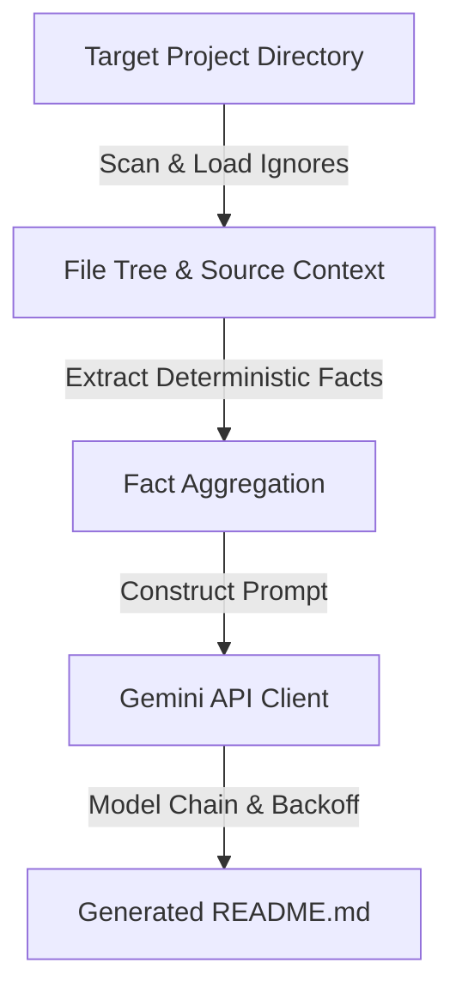

<!-- AUTO-GENERATED-AI-README -->

# ai-readme-generator

A command-line interface (CLI) tool that scans target project directories, respects `.gitignore` rules, extracts deterministic facts, gathers source code within a size budget, and uses the Gemini API to generate `README.md` files complete with Mermaid architecture diagrams.

## Project Overview

`ai-readme-generator` automates project documentation by computing deterministic ground truths (such as project structure, package manager manifests, and configuration) and sending them alongside bounded source code contexts to the Google Gemini API. It inserts a sentinel marker at the top of generated files to prevent overwriting hand-written READMEs unless forced.

## Features

- Scans target project directories while filtering out common build artifacts and dependencies.
- Respects project-level `.gitignore` rules combined with default ignore patterns.
- Prioritizes manifest and configuration files within context size limits.
- Automatically extracts verifiable code facts (Python version, console commands, and license presence) to supply as ground truth to the model.
- Automatically falls through a sequence of Gemini models with retry and exponential backoff logic on API errors.
- Prevents accidental overwrites of manually edited documentation using a sentinel marker.

## System Architecture



## Folder Structure

```text
github-automation/
├── .github/
├── ai_readme/
│   ├── __init__.py
│   └── generator.py
├── .env.example
├── .gitignore
├── pyproject.toml
└── README.md
```

- **`ai_readme/`**: Contains the core package logic, including directory scanning, model querying, and CLI handling.
- **`.env.example`**: Template file indicating required environment variables for API authentication.
- **`pyproject.toml`**: Project metadata, dependencies, and console script entry point definition.

## Tech Stack

- **Language:** Python >=3.9
- **API Client:** `google-genai`
- **Configuration & Utilities:** `python-dotenv`, `pathspec`

## Installation

1. Ensure Python >=3.9 is installed.
2. Clone the repository and install the package with its dependencies:

```bash
pip install .
```

3. Configure your Gemini API key by copying `.env.example` to `.env` and setting your API key:

```bash
cp .env.example .env
```

Edit `.env` to include your key:
```env
GEMINI_API_KEY=your_actual_api_key_here
```

## Usage

The package exposes the `gen-readme` console command. 

```bash
gen-readme [options]
```

### Options and Behavior

- The tool checks for the presence of an existing `README.md` containing the sentinel marker (`<!-- AUTO-GENERATED-AI-README -->`). If the marker is missing, generation is aborted to protect manual documentation unless forced.
- Uses a model fallback chain (`gemini-3.5-flash-lite`, `gemini-3.8-flash`, `gemini-3.7-flash`, `gemini-3.6-flash`, `gemini-3.5-flash`, `gemini-3.1-flash-lite`) with up to 3 attempts per model using exponential backoff.
- Limits source context sent to the API to a maximum budget (`MAX_CONTEXT_CHARS` of 60,000 characters), truncating individual files at `MAX_FILE_CHARS` (3,000 characters) while prioritizing manifest files (`package.json`, `requirements.txt`, `pyproject.toml`, etc.).

## Data Handling and Privacy

This project sends data to an external service (the Google Gemini API). 

- **Source Code Transmission:** The tool scans project files, builds a file tree, and transmits source code snippets and configuration contents up to a 60,000-character budget to the Gemini API.
- **Ignore Rules:** Excludes files matched by `.gitignore` as well as default ignore patterns (such as `.git`, `node_modules`, `venv`, `.env`, private keys, and certificate files).
- **Security Warning:** Secrets residing in files that are not caught by `.gitignore` or the default ignore patterns will be sent to the external API.
